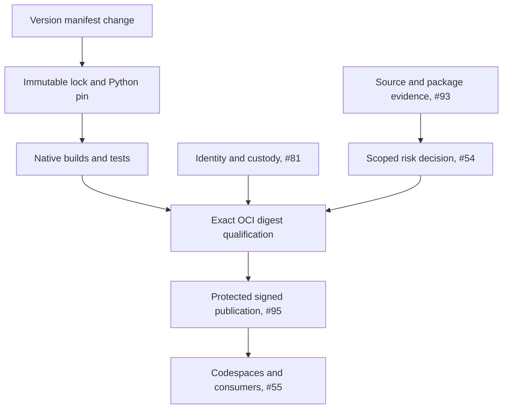

# DEV-10 identity and release reconciliation

**19 November 2026** | [PR #74](https://github.com/baobab-platform/baobab-dev/pull/74)

The audited repository baseline was `main` at `bc6ca0a9f7d28c8baa41a903642ff808c99e84f2`. The [audited PR head](https://github.com/baobab-platform/baobab-dev/commit/8927efb349878a61c1ee6c23511575dc7d2ac2e3) was `8927efb349878a61c1ee6c23511575dc7d2ac2e3`, 609 commits ahead and zero behind. GitHub Actions used synthetic PR merge commit `d6f391be8de5ac75ced2cdbb3bff462f60e8cd80`. Source presence and check results from earlier heads carry different evidentiary weight from a qualified release at the current head.

## Issue and implementation register

| Authority and requirement | Audited source and ownership | Finding and disposition |
| --- | --- | --- |
| [#81](https://github.com/baobab-platform/baobab-dev/issues/81) GII-01 promotion actor and reviewer independence | #82, transplanted into #74 at `46f66c7595a884983299e9c8411caa155f97b927`. The verifier at the audited head matches #82's final blob. Publish retained #74's dynamic same-source RC selection. | **PARTIAL**. The workflow resolved the rerun actor through a mutable login lookup. The correction gets typed numeric identities from the exact repository, workflow, run, attempt and tagged source, then compares approved reviewers by ID. The v2 evidence format and protected deployment gate remain in use. **IMPLEMENTED BUT UNQUALIFIED** pending hosted and protected-attempt evidence. |
| #81 GII-06 and GII-14 safe GitHub API transport | #83 and #87, `scripts/github_api_transport.py`, `scripts/custody_independence.py`, `scripts/provision_protected_risk_policy.py`, `scripts/verify_protected_risk_custody.py`. #90 proposed separate transport negatives. | **CONFIRMED**. The inherited formatter could emit arbitrary top-level error messages, transport reasons and GraphQL path strings. The scan-time verifier and diagnostic reviewer audit bypassed bounded transport. Shared transport now restricts URL and read redirects, bounds bodies, closes responses and reports only permitted diagnostics. **IMPLEMENTED BUT UNQUALIFIED**. |
| #81 GII-07 and GII-08 exact committer corroboration | #80 baseline, #84/#87 and `scripts/custody_independence.py`. | **CONFIRMED**. The baseline could attempt REST on a malformed link and accepted missing co-author pagination state as complete. The correction requires an explicit null committer link, exact SHA, raw name/email/time agreement and a linked numeric User. Every resolved contributor, including the platform service User, remains in the exclusion set. **IMPLEMENTED BUT UNQUALIFIED**. |
| #81 GII-08 and GII-13 read and write custody | #84, `scripts/verify_protected_risk_custody.py`, `scripts/provision_protected_risk_policy.py`. #74 already carried #84's stronger provisioner checks. | **CONFIRMED**. The read path had weaker account typing, duplicate and ordering checks, and omitted owner concurrence. Both paths now require the same exact merged bytes, ancestry, attributable owner concurrence and effective pre-merge approval independent of contributors. **IMPLEMENTED BUT UNQUALIFIED**. |
| #81 review of maintenance release authority | #74, `scripts/release_eligibility.py`. See [maintenance review follow-up](https://github.com/baobab-platform/baobab-dev/pull/74#issuecomment-6971636994). | **CONFIRMED**. The live path imported a missing `uid` helper. It now corroborates REST/GraphQL author IDs, proves the independently reviewed declaration at the exact head and merge commit, and excludes every contributor. **IMPLEMENTED BUT UNQUALIFIED**. |
| #81 GII-05 historical reviewer contribution | #85/#86 and [#76](https://github.com/baobab-platform/baobab-dev/pull/76). | **PARTIAL**. An independent REST and local Git reconstruction matches the historical custody evidence below. The updated policy-contract workflow also exercises the historical GraphQL join. Historic platform protection and provisioning receipts remain separately verifiable. |
| #81 GII-02, GII-09 and GII-10 live evidence and API volume | #88 and `tests/test_custody_independence.py`. | **PARTIAL**. The fixture now uses an exact immutable service-committer SHA and independently corroborated ID. Hosted qualification, successful request receipts and per-run rate-limit measurement remain due. |
| #81 GII-11 role model | #89, `scripts/github_identity_roles.py` on the prototype branch. | **PARTIAL**. The eight roles identify real trust boundaries. The prototype accepts caller-supplied provenance labels and deliberately leaves human eligibility unresolved. Keep it in review. The live paths continue to require role-specific GitHub evidence and the existing governed appointment. |
| #81 GII-03 and GII-12 branch protection and bypass | `.github/CODEOWNERS`, ADR-DEV10-001, repository branch and ruleset APIs. | **BLOCKED** for protected release. `main` metadata reports `protected: false` and the branch-rules readback returned an empty array. The detailed branch-protection endpoint returned HTTP 403, leaving its admin-only settings unverified. The active [tag ruleset](https://github.com/baobab-platform/baobab-dev/rules/20470719) has the stored pattern `refs/tags/refs/tags/v*` and always-bypass roles. That pattern does not match ordinary `refs/tags/v…` release refs. |
| [#95](https://github.com/baobab-platform/baobab-dev/issues/95) single manifest and generated files | #74, `config/resolve.sh`, `.github/workflows/update-lockfile.yml`, Publish `sanity-check`. | **CONFIRMED GAP**. Publish rejects drift and asks for a local update or a separate scheduled-branch PR. An approved same-branch writer, unprivileged fork output and manifest-only/no-op qualification remain **BLOCKED** as acceptance evidence. |
| #95 one reusable build, security decision and protected publication | #74, Foundation container gate, Publish `build`, `release-digests`, `ga-reuse`, `publish`, `promote` and `release`. | **PARTIAL**. The workflow has exact-digest checks and same-source RC-to-GA reuse. It still builds local scan copies, has a separate Foundation image build and uses tagged RC/GA lifecycle machinery. A manifest-only change has no complete qualified path. |
| #95 diagnostic workflow scope and rollback | #74, `dev10-onboarding.yml`, `dev10-ubuntu-source.yml`, promotion monitor, registry integrity and `docs/usage/immutable-rc-recovery.md`. | **PARTIAL**. The pinned Ubuntu history check is path-scoped. Always-on onboarding still builds historical provenance and source-evidence jobs. The rollback tooling needs a successful rehearsal with qualified digests. |
| [#54](https://github.com/baobab-platform/baobab-dev/issues/54) independently authorized residual risk | #74 and separate draft #92. Active bytes in `security/decisions/development/foundation.json`, historical disclosure in `scripts/dev10_kernel_risk_gate.py`, strict release verifier in `scripts/verify_digest_security_decision.py`. | **BLOCKED**. The current eight-finding decision and draft twelve-finding amendment both miss the verified inventory. The release gate refuses residual HIGH/CRITICAL findings independently of development approval. |
| [#93](https://github.com/baobab-platform/baobab-dev/issues/93) source ancestry and backport evidence | #91 plus #74's pinned-source implementation, `scripts/audit_ubuntu_kernel_fix_history.py`, `security/evidence/dev10-kernel-evidence.lock.json`. | **IMPLEMENTED BUT UNQUALIFIED**. The latest job stopped in a synthetic fixture because `git cherry-pick` does not support `-q`. Corrected the fixture and kept upstream candidate, exact tag, ancestry, backport ambiguity and package evidence as technical inputs. All 298 dispositions remain under investigation. |
| [#55](https://github.com/baobab-platform/baobab-dev/issues/55) real developer acceptance | #74 and DEV-14, `.github/workflows/dev10-onboarding.yml`, `scripts/ci/onboarding-published-image.sh`. | **BLOCKED**. The existing v1.5.1 image yields GitHub CLI `DEV` against the strict `2.102.1` pin. A suitable candidate and genuine fresh Codespaces, private packages, native and browser consumers, rollback, and teardown remain acceptance prerequisites. |

The [v1.5.1 promotion environment](https://api.github.com/repos/baobab-platform/baobab-dev/environments/dev10-release-promotion) separately reports three required reviewer entries, self-review prevention and custom deployment policies. [Deployment policy readback](https://api.github.com/repos/baobab-platform/baobab-dev/environments/dev10-release-promotion/deployment-branch-policies) shows `v*.*.*` and `v*.*.*-rc.*` as tag patterns. This evidence describes the environment. The effective branch and release-tag rules, privileged bypass settings and a new protected run still need acceptance.

## Role and provenance

| Role | Evidence | Use |
| --- | --- | --- |
| PR author | Matching REST `User.id` and GraphQL `User.databaseId` | Decision preparer attribution and mandatory exclusion |
| Commit author | Linked User on exact GraphQL Git object | Mandatory exclusion, including the author of a merge commit |
| Co-author | Complete GraphQL GitActor author connection with counts and page state | Mandatory exclusion |
| Committer | Linked User on exact GraphQL Git object. An explicitly unlinked committer can use typed REST corroboration against the same SHA and raw metadata | Mandatory exclusion, including service Users |
| Reviewer | Effective typed GitHub review, governed numeric identity, exact PR head and contributor comparison | Independent review |
| Owner | Typed User at the appointed immutable ID, pre-merge comment and edit times | Separate accountable concurrence |
| Workflow initiator | Runtime actor ID and typed original and triggering actors on the exact Actions run attempt | Attribution and exclusion from promotion self-review |
| Merger | GitHub merged PR metadata, merge commit and ancestry | Merge attribution and lineage. Authority remains with the independent review and enforced controls |

A GitHub User account can be operated by a service. The observed immutable web-flow ID is excluded from approval roles and remains in contributor history. Human eligibility beyond the governed appointment requires separate authenticated evidence.

### Historical custody checkpoint

REST returned 94 commits for #76 and local Git produced the same count over the recorded base and merged-head range, with no co-author trailers. The numeric contributor set was `{350241706, 356890520, 19864447}`. The account with ID `356890520` authored merge commit [dad5dc6](https://github.com/baobab-platform/baobab-dev/commit/dad5dc64031d05b7e7d93345f1ea553abea6c70e) and is ineligible for this review. The GitHub service User with ID `19864447` committed it and remains in the set. The distinct reviewer ID `356900102` submitted [review 5932308847](https://github.com/baobab-platform/baobab-dev/pull/76#pullrequestreview-5932308847) on exact head `f9fd73d4e848a7c4d3bcfbe28651e06149cdcb6d` at 05:28:08 SAST before the 05:36:58 SAST merge. The typed owner User ID `49340314` supplied [comment 6924572973](https://github.com/baobab-platform/baobab-dev/pull/76#issuecomment-6924572973) before merge. The final-head live GraphQL and permission-bound receipts remain part of the qualification exit.

## Scanner and CI evidence

[Foundation run 44480847361](https://github.com/baobab-platform/baobab-dev/actions/runs/44480847361) and [Publish run 44480846334](https://github.com/baobab-platform/baobab-dev/actions/runs/44480846334) refused the candidate. All nine downloaded archives matched GitHub's artifact SHA-256. Their review-only inventories were identical at the CVE/package/version/severity/ecosystem level. Each had **52 Ubuntu findings, 3 Critical and 49 High**, for `linux-libc-dev 7.0.0-43.43`. Forty-four fall outside the eight-finding decision and 41 fall outside #92. The draft picomatch record does not appear in these nine scans. No applicability or policy disposition follows from this inventory.

| Scan | Artifact | ZIP SHA-256 |
| --- | --- | --- |
| Foundation final amd64 | [14510594647](https://github.com/baobab-platform/baobab-dev/actions/runs/44480847361/artifacts/14510594647) | `sha256:c862536408d7f6e256775139f4440828c0040bcdcd6c3f7e9d89dafd53c255da` |
| final-amd64 | [14510676196](https://github.com/baobab-platform/baobab-dev/actions/runs/44480846334/artifacts/14510676196) | `sha256:dcfeb8a8a61d8812d9103d49aad0d1d7c3a5d8c0e3ab9ddc14ba1c75c090b141` |
| final-arm64 | [14509209819](https://github.com/baobab-platform/baobab-dev/actions/runs/44480846334/artifacts/14509209819) | `sha256:25d27563c5bfe258cf1818d40bfe2ac17c31cb1b91baecac5b2c82e905f914df` |
| frontend-amd64 | [14509607751](https://github.com/baobab-platform/baobab-dev/actions/runs/44480846334/artifacts/14509607751) | `sha256:c7e0f02884b70b298f8d9cd34f758d23c888178e8b0e2086dd06de922ce0b2db` |
| frontend-arm64 | [14510305066](https://github.com/baobab-platform/baobab-dev/actions/runs/44480846334/artifacts/14510305066) | `sha256:98d0722edd94b9dd9a3ce9b8d597f0768726d35640edefab590c1ad4883da82d` |
| frontend-e2e-amd64 | [14509928560](https://github.com/baobab-platform/baobab-dev/actions/runs/44480846334/artifacts/14509928560) | `sha256:cb9416089b236b8efdc68c5186ee038ba8d4c3ec48f27263d7bce9e05967bb24` |
| frontend-e2e-arm64 | [14510400932](https://github.com/baobab-platform/baobab-dev/actions/runs/44480846334/artifacts/14510400932) | `sha256:78ed1afc3bec1455c4b3ed318b4c1b80c100656ba4837647f0a08b7c217157f3` |
| infra-amd64 | [14510425361](https://github.com/baobab-platform/baobab-dev/actions/runs/44480846334/artifacts/14510425361) | `sha256:04c4606e07e84165b16d1a8a7305707c76ccbf72dd098eeb6acd96b74ec77bcb` |
| infra-arm64 | [14509364727](https://github.com/baobab-platform/baobab-dev/actions/runs/44480846334/artifacts/14509364727) | `sha256:19605f85f5a98a9ce3c7a4db985fa8f51d8984bcf2ab8d039e0953597bc5b404` |

[Locked onboarding run 44480846461](https://github.com/baobab-platform/baobab-dev/actions/runs/44480846461) and [Ubuntu source run 44480846347](https://github.com/baobab-platform/baobab-dev/actions/runs/44480846347) hit the same invalid Git argument in the offline backport fixtures. Historical image checks also refused the immutable v1.5.1 image. The [policy contract](https://github.com/baobab-platform/baobab-dev/actions/runs/44480846474) passed on the audited head. Final-head protected release jobs were skipped after scan refusal.

The historical review findings for broad legacy risk acceptance, free-text release decisions and invalid Dockerfile healthchecks were checked in source. The legacy validator always refuses, the release verifier rejects unapproved residual risk, and all four Dockerfile stages now invoke a real shell for the process-liveness healthcheck. Runtime health for the candidate still requires a live witness. [PR #74 review threads](https://github.com/baobab-platform/baobab-dev/pull/74)

## Consolidation

| PR | Treatment |
| --- | --- |
| #82 | Closed unmerged. The numeric evidence transplant is present and was the baseline for the run-attempt correction. |
| #83/#84 | Closed unmerged. Their merged-history diagnostics and typed-reviewer protections are present on #74. The runtime gaps identified above have focused corrections. |
| #85/#86 | #85 closed unmerged. The three evidence-file blobs represent the same historical scope on #86. Preserve #86 for reconciliation with the live custody run. |
| #87/#88/#90 | Retain the security analysis, live evidence design and transport matrix as review provenance. Compare remaining unique scope after #74 qualification. |
| #89 | Keep the read-only eight-role prototype separate from live authorization pending an approved evidence contract. |
| #91 | Keep open. The 298-record inventories and path auditor are present in #74, but its looser upstream reference parser and stale branch diff should not replace the pinned #74 implementation. Require consolidated current-head source and consumer evidence before supersession. |
| #92 | Retain as a separate decision PR. The earlier draft fails its base schema and remains outside the current scanner inventory. Any new decision requires fresh scope, independent review, owner concurrence, exact merged bytes and protected provisioning. |

## Product dependency

The initial product increment should resolve the two generated files without privileges, bind output to the exact head and version manifest, and give approved same-repository automation custody of just those files. A fork receives an artifact for maintainer follow-up. The qualifying job should consume the resulting reviewed commit and reuse its OCI artifacts across native scans, smoke, SBOM and provenance. The protected publication job needs an independently approved merged source and exact accepted digests before releasing convenience tags. Registry integrity, kernel history and notification workflows can run independently of routine upgrades, with their own evidence. Keep current release and rollback controls in place until the replacement path passes end-to-end qualification with real consumers.

The audit status of #74 is **BLOCKED** for merge and release. Identity implementation and local negatives are reviewable. Current image remediation or a separately authorized development decision, effectively enforced release controls, source evidence and real consumer acceptance remain distinct gates.
